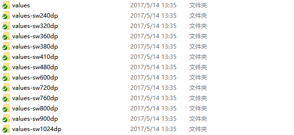
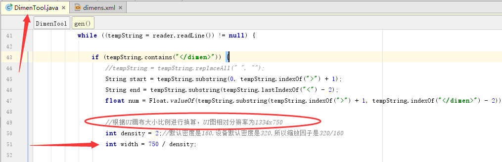
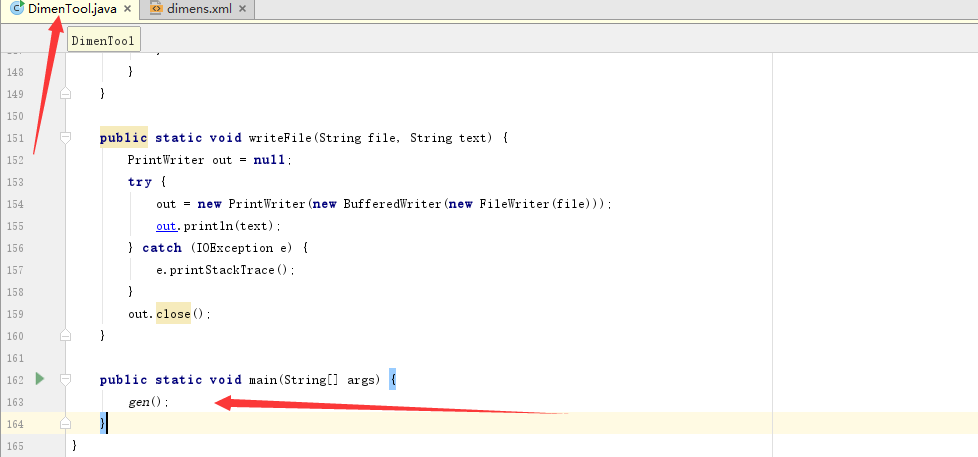
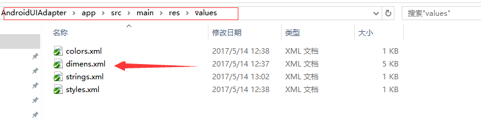

# AndroidUIAdapter
安卓屏幕适配方案，只需一个步骤即可使用，也可根据自己项目设计图画布大小和像素尺寸实时精准适配，适配所有市面上各种大小不一的安卓手机屏幕，特点是可以直接在Android studio的XML编辑器中直接预览不同手机屏幕的适配效果，提高工作效率，且完全不会有性能问题，极易上手。且可以根据你项目的dimen.xml文件自动生成多尺寸的dimen.xml文件！

## 说明

dp只是相对单位；

dp = 屏幕相对分辨率（如：1920 * 1080） / 相对密度

举个栗子：

dp = （相对宽度）1080 / （密度比）3 = 360 dp;  则其自动适配的文件夹即为 values-sw360dp

### 使用

1. **第一步，复制该项目res目录下包含dimens.xml的velues文件夹到自己的项目的res目录下，其中values文件夹只复制其dimens.xml文件**

   

2. **直接在项目中引用， px / 密度 = dp（通常密度为2，例：10px / 2 =  5dp）**

   ```
   <Button
       android:layout_width="match_parent"
       android:layout_height="@dimen/widget_size_45"
       android:layout_marginTop="@dimen/widget_size_10"
       android:textSize="@dimen/font_size_10"/>
   ```

   ​

### 可选配置（生成多尺寸 dimens）

##### 第一步：确认设计稿宽度（联系美工确认设计图尺寸）

默认按设计宽 **360dp**（1080px @ density 3）。若设计稿不同，生成时传入 `-PdesignWidth`，例如 750px @ density 2 → `375`：

```bash
gradle :library:generateDimens -PdesignWidth=375
```



##### 第二步：执行生成，得到各档 `values-sw*dp/dimens.xml`

```bash
gradle :library:generateDimens
```

也可在 IDE 中运行 `DimenTool.main`（支持 `--design-width` / `--buckets` / `--input` / `--output-dir`）：



常用参数：

```bash
# 自定义 sw 档位（文件夹名与缩放系数一致）
gradle :library:generateDimens -Pbuckets=240,320,360,410,480,600,720

# 指定输入/输出路径
gradle :library:generateDimens -PdimensInput=app/src/main/res/values/dimens.xml -PdimensOutputDir=app/src/main/res
```

生成规则：

- 仅缩放 **dp/dip**；**sp**（字体）与 **px**（细线）保持原值，避免破坏无障碍与物理像素线
- `values-sw380dp` 按 **380** 缩放（不再误用 384）；`values-sw760dp` 按 **760** 缩放（不再误用 768）
- 已存在的 `dimens.xml` 会被直接覆盖

### 注意

**如果 dimens.xml 中没有想要的尺寸，在 `values/dimens.xml` 中添加后，再执行 `generateDimens` 即可。**



## 获取屏幕密度比

查看设备分辨率：
adb shell wm size 

查看屏幕密度（DPI）：
adb shell wm density

#### 标准DPI = 160 (google规定的，听说因为第一个android设备DPI就是160，所以标准DPi就被设置为160了) 

屏幕密度DPI / 标准DPI = 密度比

举个栗子：

使用 adb shell wm density 指令得到：Physical density: 200

则密度比 = 200 / 160 = 1.25

## Download  [](https://jitpack.io/#cheng2016/AndroidUIAdapter)
    implementation 'com.github.cheng2016:AndroidUIAdapter:V1.0.0'
<br/>


#### 屏幕适配参考链接

[一分钟了解Android屏幕 ldpi mdpi hdpi xhdpi](http://www.2cto.com/kf/201506/404773.html)

[Android屏幕大小适配问题解决](http://www.2cto.com/kf/201405/301671.html)

[Android屏幕适配小技巧sw<n>dp](http://blog.csdn.net/chenzujie/article/details/9874859)

[AndroidAutoLayout](https://github.com/hongyangAndroid/AndroidAutoLayout)

[约束布局ConstraintLayout强烈推荐](https://www.jianshu.com/p/17ec9bd6ca8a)

[Android使用ADB命令查看设备分辨率和屏幕密度（DPI）](https://www.isilent.me/903.html))
	
[dpi 、 dip 、分辨率、屏幕尺寸、px、density 关系以及换算](https://www.cnblogs.com/yaozhongxiao/p/3842908.html))
	
## 其他推荐

#### [AndroidUtils常见工具类集合](https://github.com/cheng2016/AndroidUtil)

[ImageDownLoader 手写的三级缓存框架二百多行代码搞定图片缓存](https://github.com/cheng2016/AndroidUtil/blob/master/util/ImageDownLoader.java)
	
	
## Contact Me

- Github: github.com/cheng2016
- Email: mitnick.cheng@outlook.com
- QQ: 1102743539
- [CSDN: souls0808](https://blog.csdn.net/chengzhenjia?type=blog)

## 如果对你有帮助，欢迎打赏，您的打赏是我分享的最大动力！！

   

# License

    Copyright 2016 cheng2016,Inc.
    
    Licensed under the Apache License, Version 2.0 (the "License");
    you may not use this file except in compliance with the License.
    You may obtain a copy of the License at
    
        http://www.apache.org/licenses/LICENSE-2.0
    
    Unless required by applicable law or agreed to in writing, software
    distributed under the License is distributed on an "AS IS" BASIS,
    WITHOUT WARRANTIES OR CONDITIONS OF ANY KIND, either express or implied.
    See the License for the specific language governing permissions and
    limitations under the License.


